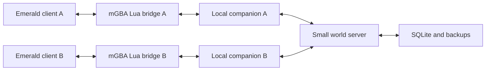

# Pokémon Emerald private multiplayer technical foundation

Research date: October 7, 2026. Initial clients: Windows PCs, as confirmed by the project owner. Status: proposed architecture for agreement before Phase 1.

Start directly from **RHH pokeemerald-expansion 1.17.1**, which builds on pret's Emerald decompilation. Use an emulator-assisted connection to a small persistent server, while each client continues running its own Emerald game. This best combines mature Pokémon engine work with independent multiplayer play. The complete vision is plausible as a sustained custom engineering project; the selected components do not already implement the finished game.

The first gate is an unmodified reproducible build. The next gates are two-client movement and safe independent persistence. Trading and conventional battles must prove the networking architecture before significant content work. No gameplay implementation, engine import, emulator playtest, or build has occurred in this research phase.

## Source and expansion

Use [rh-hideout/pokeemerald-expansion](https://github.com/rh-hideout/pokeemerald-expansion), pinned to [expansion/1.17.1](https://github.com/rh-hideout/pokeemerald-expansion/releases/tag/expansion/1.17.1), released September 29, 2026. The exact commit is `bb1093a7c72d3961d9a37d8e02ad2abc2c866682`; its tag was also verified with `git ls-remote`. Record both tag and commit. Upstream updates should be deliberate migrations from a checkpoint, rather than automatic pulls from `master` or `upcoming`.

[pret/pokeemerald](https://github.com/pret/pokeemerald) remains the source reference for the original Emerald engine. RHH already incorporates that foundation, so beginning with vanilla and separately merging the complete expansion adds avoidable integration work. A separate vanilla matching build is useful for comparison, but the required project baseline should be the unmodified pinned RHH source. RHH says its existing link functionality interoperates with expansion builds, not official games; our clients must use the same project build. [RHH overview](https://rh-hideout.github.io/pokeemerald-expansion/)

RHH supplies expanded Pokémon, move, ability, and item data; Mega Evolution; multi-battle infrastructure; overworld Pokémon and followers; developer tools; and an integrated test runner. Its follower work already includes dynamic overworld palettes and sprites beyond the requested roster. Reuse that integrated implementation before considering another follower fork. Custom reactions, remote followers, and the complete player selection interface still need project work. Maps and additional regions become source content in the same engine, edited with Porymap. [RHH feature list](https://rh-hideout.github.io/pokeemerald-expansion/FEATURES.html)

Do not use FireRed-specific CFRU/DPE as an Emerald foundation. A finished hack such as [Quetzal](https://www.pokemonquetzal.app/) can inform playtesting and design, but should not be adopted as a source base without an exact current source release, permission terms, upstream provenance, and compatibility review. An available game or patch does not establish reusable source access.

### Generation 5 rules

The pinned expansion defaults `GEN_LATEST` to `GEN_9`. Later, create an explicit Gen 5 profile: `GEN_LATEST = GEN_5`, audited individual settings, and a named ruleset version. Do not change this in the clean Phase 1 build. [General configuration](https://github.com/rh-hideout/pokeemerald-expansion/blob/expansion/1.17.1/include/config/general.h)

Audit stats, abilities, types, experience, friendship, evolution methods, learnsets, and move availability. `P_UPDATED_TYPES`, `P_UPDATED_STATS`, `P_UPDATED_ABILITIES`, and `P_LVL_UP_LEARNSETS` support generation selection; the Gen 5 level-up data uses B2W2. This does not establish that every acquisition method or edge case matches Gen 5. [Pokémon configuration](https://github.com/rh-hideout/pokeemerald-expansion/blob/expansion/1.17.1/include/config/pokemon.h)

The battle audit must cover the physical/special split, type chart, permanent ability weather, critical damage, paralysis, confusion, sleep, Hidden Power, Knock Off, Steel's resistances, experience, move effects, and boolean defaults that do not follow `GEN_LATEST`. Disable unapproved later mechanics and acquisition paths, including Z-Moves, Dynamax, Terastallization, and Primal Reversion. Representative Gen 5 tests should exercise actual battle results. [Battle configuration](https://github.com/rh-hideout/pokeemerald-expansion/blob/expansion/1.17.1/include/config/battle.h)

Use an explicit National Pokédex allowlist of entries 1–649, with approved forms stored separately. Generation toggles alone can leave cross-generation evolutions, regional forms, or later Mega forms enabled. Mega forms require additional internal species IDs, so 649 roster entries does not mean only 649 internal records. Species configuration changes can alter the Pokédex save layout. Phase 3 must therefore version the profile, and Phase 5 must supply a tested migration for retained earlier saves; no proof-of-concept save will be discarded without agreement. [Species configuration](https://github.com/rh-hideout/pokeemerald-expansion/blob/expansion/1.17.1/include/config/species_enabled.h)

**A gameplay decision is required before Mega implementation:** Mega Gardevoir, Mawile, Altaria, and Audino introduce Fairy typing, and some introduce Fairy-dependent abilities. Gen 5 type settings do not automatically rewrite those Mega definitions. Retaining every such Mega while forbidding Fairy requires approved custom types and possibly abilities, or a deliberate exception to the rule. No choice has been made. Mega timing rules, which Mega catalogue is allowed, and Rayquaza's unusual access requirements also need explicit decisions; the expansion's newest Mega additions should not be enabled silently. [Gen 3 Mega definitions](https://github.com/rh-hideout/pokeemerald-expansion/blob/expansion/1.17.1/src/data/pokemon/species_info/gen_3_families.h), [Gen 5 Mega definitions](https://github.com/rh-hideout/pokeemerald-expansion/blob/expansion/1.17.1/src/data/pokemon/species_info/gen_5_families.h)

### Licenses and asset provenance

Neither pret nor the pinned RHH tree declares a blanket root license. RHH requests credit, but credits are not a permission grant covering all decompiled game material or contributed art. Use a dependency and asset ledger recording exact revision, source, attribution, applicable terms, and any unresolved permission before copying third-party additions. Public source availability and private use do not establish blanket asset rights. [pret repository](https://github.com/pret/pokeemerald), [RHH repository](https://github.com/rh-hideout/pokeemerald-expansion)

The separate tools have explicit licenses: [mGBA MPL 2.0](https://github.com/mgba-emu/mgba/blob/0.10.5/LICENSE), [Porymap LGPL 3.0](https://github.com/huderlem/porymap/blob/master/LICENSE.md), and [Poryscript MIT](https://github.com/huderlem/poryscript/blob/master/LICENSE.md). Wired-Ariel's networking project is [GPL 3.0](https://github.com/Wired-Ariel/gen3-poke-multiplayer/blob/main/LICENSE), with [third-party notices](https://github.com/Wired-Ariel/gen3-poke-multiplayer/blob/main/THIRD_PARTY_NOTICES.md). TheHunterManX's Lua project uses [CC BY NC 4.0](https://github.com/TheHunterManX/GBA-PK-multiplayer/blob/main/LICENSE.md), which should not be mistaken for a permissive software license. No third-party implementation has been incorporated during this phase.

## Development and testing environment

Use **Ubuntu 24.04 LTS in WSL2**, building on the Linux filesystem, with Windows mGBA for interactive testing. This machine already has Ubuntu 24.04.4 under WSL2, plus Linux `make`, `git`, and `python3`; `arm-none-eabi-gcc` was not found. Windows Git 2.53.0 is installed. The upstream WSL instructions favor the Linux filesystem for WSL2 builds. Keep the active build tree and live SQLite database outside OneDrive; the present workspace can retain the research documents. [Pinned WSL instructions](https://github.com/rh-hideout/pokeemerald-expansion/blob/expansion/1.17.1/docs/install/windows/WSL.md)

Use GNU Arm Embedded GCC/binutils and newlib through Ubuntu's packages, rather than the original matching compiler. RHH defaults to its modern GCC build; its CI uses these packages. Record package versions after installation and retain a rebuild manifest. Ubuntu 24.04's GCC package is based on Arm GCC 13.2.rel1. Python 3.12 from Ubuntu is sufficient for the proposed companion/server and source tooling. Neither agbcc nor devkitARM is required for this selected modern build. [Pinned CI recipe](https://github.com/rh-hideout/pokeemerald-expansion/blob/expansion/1.17.1/.github/workflows/build.yml)

The planned dependency installation is:

```bash
sudo apt update
sudo apt install build-essential binutils-arm-none-eabi gcc-arm-none-eabi libnewlib-arm-none-eabi git libpng-dev python3
```

The planned source and build commands are:

```bash
mkdir -p ~/src/pokemon
cd ~/src/pokemon
git clone https://github.com/rh-hideout/pokeemerald-expansion engine
cd engine
git switch -c codex/baseline expansion/1.17.1
git rev-parse HEAD
make -j$(nproc)
make check -j$(nproc)
```

`HEAD` must match the pinned SHA. `make` produces `pokeemerald.gba` and `pokeemerald.elf`. Use `make debug` for symbols and `make release` for a separate release build when needed. Debug replaces the normal build's filenames: archive the normal outputs first, and do not build normal/debug variants concurrently in one tree. The test target uses the bundled mGBA test tool and Hydra runner. Record upstream known failures separately from new regressions. Repeat a clean build with identical settings and compare hashes before claiming reproduction. [Pinned Makefile](https://github.com/rh-hideout/pokeemerald-expansion/blob/expansion/1.17.1/Makefile), [build instructions](https://rh-hideout.github.io/pokeemerald-expansion/INSTALL.html)

Use **Windows x64 mGBA 0.10.5**, the current official stable release, for development. Use two isolated client directories first and four later, with a separate ROM copy and `.sav` path per client. Never let emulator instances write the same save. Keep pause, fast-forward, rewind, and savestate restoration in the test matrix because they affect network timing and revision handling. [mGBA downloads](https://mgba.io/downloads.html)

Use the bundled test runner for engine regression tests and the GUI emulator for actual gameplay lifecycles. A second emulator can help diagnose a suspected emulator bug, but the network adapter is initially mGBA-specific. Porymap 6.3.1 is suitable for map inspection and later controlled test maps; Poryscript is optional for later event scripting. Do not install a large content toolchain before the baseline needs it. [Porymap releases](https://github.com/huderlem/porymap/releases), [Poryscript](https://github.com/huderlem/poryscript)

## Network options

| Option | Fit for this project | Recommendation |
| --- | --- | --- |
| Traditional GBA link emulation | Useful battle/trade engine reference, but no continuous independent shared overworld or persistent world coordinator. | Do not use as the world transport. |
| Whole emulator synchronization | Synchronizes frames and hardware state, coupling latency and scene timing to all peers. | Do not synchronize the whole adventure in lockstep. |
| Existing injected Emerald multiplayer | Demonstrates independent movement, remote object animation, and map transitions; tied to vanilla offsets and layouts. | Audit and adapt useful modules and tests. |
| Emulator bridge plus small server | Supports independent local games, central shared state, safe transactions, and later transport replacement. | Preferred first architecture. |
| Native Emerald port | Removes many hardware constraints and permits direct sockets; expansion integration is a separate porting effort. | Preserve as an evaluated fallback. |

The concrete prior art is [Wired-Ariel/gen3-poke-multiplayer](https://github.com/Wired-Ariel/gen3-poke-multiplayer), with [v1.7.2](https://github.com/Wired-Ariel/gen3-poke-multiplayer/releases/tag/v1.7.2) as a reference checkpoint. It provides four-player overworld presence, movement and map transitions, and automated multi-emulator movement checks. It targets unmodified English/Italian Emerald using an injected payload and fixed engine addresses. Its relay has no canonical player saves, events, or transaction system. It reports crowded-map and scene-specific limitations. The latest patch's testing claims are not proof of compatibility with RHH.

Stock mGBA Lua does not expose a serial link-partner API. Wired-Ariel's v1.7.2 README describes an emulator Cable Club limitation, but its source contains a workaround that fills the game's `gLink` queues and assigns roles for two emulators. This documentation/source conflict leaves the actual emulator trade/battle lifecycle unverified for our purposes; direct testing is required. Neither path establishes RHH compatibility or transactional saves. A different Celio solution uses a modified emulator. [Pinned README](https://github.com/Wired-Ariel/gen3-poke-multiplayer/blob/v1.7.2/README.md), [Cable Club workaround](https://github.com/Wired-Ariel/gen3-poke-multiplayer/blob/v1.7.2/mgba/club_lua.lua)

Useful code patterns include movement actions with periodic absolute corrections, per-peer queues, settled map transitions, palette ownership, and partial TCP reads/writes. Its movement mailbox may drop data when full, and draining an input queue is not a durable gameplay acknowledgment. Reuse those ideas with typed functions in our source; replace the vanilla address tables, IRQ injection, struct casts, and presumed unused RAM with explicitly allocated data. Reliable trade/save commands need a separate acknowledged path. [Payload source](https://github.com/Wired-Ariel/gen3-poke-multiplayer/blob/main/payload/main.c), [vanilla symbol bindings](https://github.com/Wired-Ariel/gen3-poke-multiplayer/blob/main/payload/game_syms.h)

[TheHunterManX/GBA-PK-multiplayer](https://github.com/TheHunterManX/GBA-PK-multiplayer) also demonstrates Lua-side adaptation of stock battle controller buffers. It remains another address-dependent reference rather than an established RHH plugin. The project should reuse engine behavior and audited compatible components, without wholesale merging a large injection script.

## Proposed multiplayer architecture



Clients C and D later use the same structure. The world server is one ordinary process, initially Python `asyncio` with SQLite, running on one friend's PC. It may later move to an always-on machine without changing the protocol. The server does not render maps or emulate four GBAs. It coordinates presence, identity, teams, events, transactions, checkpoints, and battle rooms. No MMO infrastructure is needed.

Each modified ROM exposes a small bounded RAM mailbox. A build-generated manifest gives the bridge its address, size, version, and ROM identity. ROM code processes incoming commands at safe points in the main loop, validates data, and calls the normal engine. Lua copies messages rather than writing party structures or save blocks directly. Allocate buffers in the linker-visible memory budget; do not use a vanilla injection project's presumed free address.

The published mGBA API supplies frame/lifecycle callbacks, memory reads/writes, and TCP sockets. Lua socket connection calls can block, and socket events are checked per emulated frame. Therefore Lua connects only to the already-running loopback companion; the companion owns remote connections, retries, queues, and heartbeats. Pause or a suspended emulator must be reported as an unavailable game client even while its companion remains connected. The documented stable API does not establish direct Lua UDP, TLS, or serial link access. [mGBA scripting API](https://mgba.io/docs/scripting.html)

Use a versioned, length-prefixed TCP protocol first. The owner has selected direct Internet hosting through router port forwarding, with LAN support for local tests; a VPN is optional. Four players do not justify a custom reliable UDP implementation. Before exposing the service to the Internet, the companion/server must provide encrypted, authenticated sessions, invitation-based certificate trust, bounded message sizes, connection limits, and failed-login limits. Lua remains on loopback. Keep control messages and bulk snapshots bounded and prioritized; coalesce obsolete movement. Reconsider a separate movement transport only after measurements show a problem. Messages include protocol version, ROM and ruleset hash, player/session identity, sequence, request ID, and expected state revision. Reject incompatible builds before admitting a player.

### Downloadable Windows game

The requested product is a Windows download with one visible game entry point and **Host Game / Join Game**, for four players total including the host. A ZIP containing `Game.exe` and its runtime is sufficient for the first distribution; an installer can follow. Selecting Host starts the world server and local client automatically. Selecting Join accepts the host's address/invitation and room credentials, validates the build, and launches the local game. Profiles, settings, saves, and the host database live under the user's local application-data directory, outside the ZIP and OneDrive. Updating the application must preserve those files.

Package the launcher, companion, server, and Python runtime together on Windows. PyInstaller supports self-contained Windows executable/folder distributions without a separate Python installation; start with its one-folder mode. Friends need no WSL, source compiler, Git, required VPN, or manual emulator-script setup. This is a packaging/integration target; no downloadable client exists yet. [PyInstaller operating model](https://pyinstaller.org/en/stable/operating-mode.html)

Stock mGBA 0.10.5 remains the unchanged baseline emulator, but its command-line parser does not provide a startup `--script` option. A launcher cannot assume that flag will load our Lua bridge. After the networking proof, evaluate a small pinned mGBA front-end change to load the bridge automatically through `ScriptingController::loadFile`. A custom libmgba front end is another route, with more rendering, audio, input, and lifecycle work. Switching the whole game to a native Emerald port is not required merely to provide a downloadable desktop application. Preserve notices and provide the corresponding covered emulator source under its license. [Pinned command-line parser](https://github.com/mgba-emu/mgba/blob/0.10.5/src/feature/commandline.c), [pinned Qt options](https://github.com/mgba-emu/mgba/blob/0.10.5/src/platform/qt/ConfigController.cpp), [scripting controller](https://github.com/mgba-emu/mgba/blob/0.10.5/src/platform/qt/scripting/ScriptingController.cpp), [mGBA license](https://github.com/mgba-emu/mgba/blob/0.10.5/LICENSE)

The host reserves a stable LAN address for the PC and forwards one selected TCP game port to it, with a matching Windows firewall rule. Choose the port when implementing the server. Friends connect to the host's public address; their routers ordinarily need no inbound forwarding. The host PC must stay awake and the hosting session must keep running. Public-address changes require an updated invitation or optional dynamic DNS. If the ISP uses carrier-grade NAT, a normal home-router forward may not provide reachability; verify that when configuring the actual router. [Router manufacturer's forwarding guidance](https://www.tp-link.com/us/support/faq/1379/)

Preserve the original instruction against ROM distribution. The proposed installer imports each player's own Emerald dump once and applies our modification patch locally, validating input and reconstructed output hashes. Compilation itself does not require that dump. A patch can contain inserted game/art data, so its format and private sharing do not establish asset permissions; complete the provenance review before distribution. [BPS patch specification](https://github.com/Sir-Walrus/Flips/blob/master/bps_spec.md)

The packaging gate requires a clean Windows machine with no Python, WSL, Git, or separately installed mGBA: import the permitted game input, host/join, connect four actual clients, reject a fifth, disconnect/rejoin, save/reload, update without losing data, and close cleanly without abandoned server processes. Existing battle/trade/persistence gates still apply. Establish localhost and LAN behavior first, then test from another Internet connection through the real forward; a same-network public-address test alone does not prove remote reachability.

### Protocol messages

The proposed message families are below. Names and payload schemas will be finalized incrementally; they are not an implemented protocol.

| Family | Examples | Delivery rule |
| --- | --- | --- |
| Session | `HELLO`, `JOIN`, `RESUME`, `HEARTBEAT`, `LEAVE` | Validate build and lease; reconnect creates a new session epoch. |
| Presence | `STEP`, `TURN`, `MAP_READY`, `PRESENCE_SNAPSHOT` | Coalesce obsolete movement; reject stale map epochs. |
| Checkpoints | `CHECKPOINT_BEGIN`, `CHUNK`, `CHECKPOINT_COMMIT`, `CHECKPOINT_ACK` | Verify every chunk and final hash; acknowledge only a durable revision. |
| Interactions | `TEAM_INVITE`, `TEAM_ACCEPT`, `TEAM_LEAVE`, `TRADE_OFFER`, `TRADE_CONFIRM` | Explicit state machines and bounded requests. |
| Transactions | `TRANSACTION_COMMIT`, `APPLY_ACK`, `RECOVER_REVISION` | Persist operation IDs, retry idempotently, and never drop under backpressure. |
| Battles | `BATTLE_OPEN`, `CONTROLLER_COMMAND`, `CONTROLLER_RESPONSE`, `BATTLE_RESULT` | Ordered reliable delivery scoped to one battle. |
| Shared events | `EVENT_UPSERT`, `PARTICIPATE`, `REWARD_CLAIM` | Server revisions and durable per-player claim IDs. |

### Independent world operation

Each client runs its own map scripts, local encounters, and solo battles. Joining the server does not create a team. The server tracks all connected players, but a client only creates remote overworld actors for players in its visible map area. It does not load three additional maps into GBA RAM. Adjacent connected routes need coordinate translation; interiors and warps need visibility changes. Campaign flags stay individual except for deliberately specified shared activities.

Send a step/turn when it starts, plus periodic absolute corrections at an initially proposed 10–15 Hz maximum. Include map group/number, map transition epoch, tile coordinates, elevation, direction, walk/run/bike/surf mode, animation action, appearance, and activity. Reject old packets from a previous map or session. Replay engine movement actions for animation rather than teleporting an object every frame. Map-load readiness gates actor creation.

Followers later add species/form, shiny appearance, and follower selection to presence state. Derive a trailing path from the trainer's movement history, with corrections at warps and interrupted movement. Do not broadcast a complete Pokémon object every frame. Four trainers with four followers require an explicit object, sprite, tile, and palette budget, tested in ordinary Hoenn scenes.

Whether remote trainers block movement is a gameplay decision to confirm before the proof of concept. Nonblocking avatars are the simplest proposed starting behavior, but that rule is not approved or implemented.

### State ownership and synchronization

| State | Runtime authority | Synchronization and persistence |
| --- | --- | --- |
| Position, facing, movement, appearance, activity | Owning client; server validates session, format, and plausible map data. | Events and corrections; periodic safe location checkpoint. |
| Ordinary wild encounter and local AI battle | Owning client. | Presence reports battle status; outcomes enter the next player checkpoint. |
| Party, PC, bag, money, badges, story flags | Owning client during ordinary play; server accepts revisioned checkpoints. | Durable canonical snapshot per player; full party only when an interaction needs it. |
| Trade ownership, wager balances, shared rewards | Server transaction coordinator. | Explicit confirmation, locks, durable commit ID, idempotent application. |
| Team membership | Server. | Invite/accept/leave events; maximum two, independent wallets and inventories. |
| PvP and cooperative battle execution | One battle master client for that particular battle. | Reliable controller commands and participant responses; server coordinates membership and durable result. |
| Follower | Owning client. | Compact appearance and movement data to relevant nearby clients. |
| Event schedule, timer, participants, reward claims | Server. | Global notification; detailed entity data by location; persisted event and claim IDs. |
| Connection, player ID, session lease | Server. | Heartbeat, single active lease, reconnect handshake. |

Client authority is a trust policy for four friends, not permission to overwrite a newer transaction with an old save. Use server-issued durable player IDs; Emerald Trainer IDs are not unique network accounts. Check party bounds, Pokémon ownership, available funds, slot revisions, and duplicate operation IDs. Do not build an MMO anti-cheat system.

The server stores individual player records and shared world records separately. Shared records include world identity, active events, tournament brackets, team relationships, transaction history, and reward claims. Individual records include the complete persistent campaign state, not only badges and money. Encounter random generators are individual; shared event random selection belongs to the server.

### Battles and trades

Do not route every battle through one global battle state. A battle has its own ID, participants, controller ownership, pre-battle checkpoint, and transport queue. Two players can battle while two others explore or run separate local battles. Cooperative gyms use two human player controllers against two distinct AI opponent trainers. This controller/topology adaptation still needs a proof gate; only participating clients synchronize its execution.

RHH's link battle structure already separates a battle master from participant controllers. Adapt its command and response transport rather than implementing another damage engine in Python or assuming all peers execute the complete simulation identically. The relevant seams are controller initialization, `PrepareBufferDataTransferLink`, reception, and command acknowledgments. Replacing serial assumptions with reliable mailbox transport remains substantial work and must be proven with two actual expansion clients. [Battle controllers](https://github.com/rh-hideout/pokeemerald-expansion/blob/expansion/1.17.1/src/battle_controllers.c), [battle main loop](https://github.com/rh-hideout/pokeemerald-expansion/blob/expansion/1.17.1/src/battle_main.c)

The world server and battle master are different roles. A player's emulator closing does not inherently stop the server. Losing the battle master still requires a declared battle recovery policy. Live authority migration is deferred until resumable battle state is proven. Controller transcripts alone do not capture the complete battle state.

Direct trading should use source-level Pokémon serialization and a durable server transaction, not unsafely copy native structs through emulator memory. Validate compatible species, form, held item, checksum, ownership, and slot version. Trade evolution and held-item behavior must run through the same audited ruleset. Trade UI confirmation and a successful socket send are not completion.

For wagers, the server records each player's explicitly agreed stake in escrow, checks individual funds, and settles the result once. Team membership does not pool a wallet. A tournament is a small persisted bracket that creates conventional battle rooms. Shared activity rewards create an individual claim for each eligible player; capture ownership and eligibility rules remain undecided.

## Individual saves and world persistence

Retain Emerald's normal checksummed save pipeline, but distinguish **canonical multiplayer checkpoints**, **local `.sav` mirrors**, and **emulator savestates**. A savestate is a debugging tool, not a multiplayer database. A local older save must never overwrite a newer server transaction.

The server stores a versioned player snapshot and its revision, checksum, ROM commit, ruleset/config hash, and schema version. Its logical payload covers party, all PC storage, bag, money, flags/vars, trainer progress, location/warp information, statistics, and other persistent game state. Additional Pokémon ownership IDs and transaction records can remain outside the GBA save in a revision-bound server/companion sidecar. Stable identity requires ROM hooks for capture/creation, party/PC moves, release, evolution, trade, and import; slot positions or Trainer ID plus personality are insufficient. The ROM has to safely export/import a compatible snapshot; that is a Phase 3 feature, not an existing RHH capability.

Create snapshots only at a consistent safe point. Freeze mutations for the short export/import interval, stream chunks through a small mailbox, and stage/verify the entire snapshot externally. Do not allocate a second complete save in scarce GBA RAM. Use per-chunk bounds/sequence/checksum and a final snapshot hash. Validate fields and use ROM accessors for encrypted data before invoking the save pipeline. [Pokémon accessors](https://github.com/rh-hideout/pokeemerald-expansion/blob/expansion/1.17.1/src/pokemon.c), [save implementation](https://github.com/rh-hideout/pokeemerald-expansion/blob/expansion/1.17.1/src/save.c)

SQLite atomically stores the canonical revision before the server acknowledges it. Local game saves are recoverable mirrors; C save success or mGBA's `savedataUpdated` callback alone does not prove the host filesystem has flushed the `.sav`. A companion manifest must bind the mirror's file hash to the checkpoint revision. On reconnect, mismatched or stale mirrors recover from the canonical snapshot. Never trust a revision sidecar alone.

Ordinary progress after the last acknowledged checkpoint can be lost in a crash. Agree on save/autosave frequency and visible pending-save behavior before Phase 3; do not promise zero rollback. Save safely after major irreversible ownership/economy changes and at deliberate checkpoints. One account has one active session lease. Do not merge concurrent offline and online copies of the same character automatically.

### Trade commit and recovery

1. Enter a safe trade state and freeze both players' persistent mutations before checkpointing their current progress. Lock the offered Pokémon, affected slots, money, and player revisions; hold the freeze through abort or committed import/acknowledgment. Queue other reward/save commands. Otherwise a full post-image could erase unrelated newer progress.
2. Record the exact offer and both explicit confirmations, including player revision, Pokémon ownership ID, slot version, and transaction ID. Any change invalidates the confirmations.
3. Validate the complete exchange and both resulting player snapshots. Include trade evolution and held-item consumption in the committed outcome, computed through the agreed ROM rules, with presentation afterward; reconnect must not skip or repeat those effects. Abort an uncommitted proposal if a participant disappears.
4. Commit both ownership changes and both new canonical revisions together in one SQLite transaction. Keep the post-images and a durable result record.
5. Each ROM applies the committed result at a safe point, invokes its save path, and acknowledges the same transaction ID. Repeat delivery is harmless.
6. If a client crashes after server commit, reconnect imports its committed snapshot before allowing new party, trade, or wager mutations. Do not roll back only one side of a committed exchange.

The two local `.sav` files cannot be atomically written together across PCs. A canonical commit plus repeatable recovery supplies the guarantee. This is exactly-once effect through idempotency, not a claim of exactly-once packet delivery.

### Failure behavior

| Failure | Proposed handling |
| --- | --- |
| Player disconnects or client crashes | Remove stale presence; others continue. Rejoin with the same player ID and recover the last canonical revision. |
| Host player closes their emulator | The separate server process continues if its PC remains running. |
| Server process or host PC stops | Shared interactions stop. Restart from SQLite and its journal/backups; no automatic host migration in the first version. |
| Crash during an ordinary save | Recover the latest complete acknowledged snapshot; reject partial chunks and mismatched mirrors. |
| Trade interrupted before commit | Abort and release locks; no ownership change. |
| Trade interrupted after commit | Deliver the committed post-images on reconnect, exactly once in effect. |
| Shared battle interrupted | Preserve pre-battle snapshots and escrow. A proposed reconnect grace followed by abort/refund requires agreement before implementation; automatic forfeit is not silently imposed. |
| Server crash during battle | Recover the room/escrow record and follow the finalized interruption policy. Do not infer a winner from a half-finished client. |
| Event interrupted | Persist event ID, deadline, seed, participation, and reward claims. Recovery cannot issue the same reward twice. Timer behavior during server downtime and capture allocation require gameplay decisions. |

Keep world database backups through SQLite's backup mechanism and atomic file replacement for companion manifests. Do not back up a live database by copying only its main file while a WAL may contain committed data. Keep prior schema versions and test migrations on copies. If the server is unavailable, freeze shared transactions; whether ordinary local play may continue and later reconcile needs an explicit policy. No seamless safe offline merge is assumed.

## Hardware and engine constraints

The selected ROM remains subject to GBA memory and display limits even when emulated on a fast PC. The linker permits a 32 MiB ROM, 256 KiB external work RAM, and 32 KiB internal work RAM. Hardware supplies 96 KiB VRAM, 1 KiB palettes, and 1 KiB OAM with 128 hardware sprite entries. Faster emulation does not create more addressable RAM or palettes. [Pinned linker layout](https://github.com/rh-hideout/pokeemerald-expansion/blob/expansion/1.17.1/ld_script_modern.ld), [GBA memory reference](https://problemkaputt.de/gbatek.htm#gbamemorymap)

| Constraint | Consequence | Recommended response |
| --- | --- | --- |
| ROM budget is 32 MiB in the standard layout. | All roster graphics, audio, maps, and regions compete for space. | Track actual build usage; disable unused generations/assets where effective, compress/deduplicate, budget each region. Consider a native port if the full content exceeds the budget. |
| EWRAM and IWRAM are fixed; the expansion reserves a substantial heap. | Network buffers, four trainer parties, scene effects, and extra actors can exhaust static or dynamic memory. | Measure linker usage, peak heap, stack, and scene allocations separately. Stream snapshots and store world data externally. |
| Engine defaults are 16 object events and 64 software sprites. | Four players plus four followers use eight actors before ordinary NPCs and effects. | Reserve actors and palette/tiles explicitly; stress crowded routes, interiors, surf, weather, and transitions. Increase engine capacity only after auditing loops and measuring memory. |
| Hardware sprite palettes and object tile memory are limited. | Different followers and shiny palettes can fail even before object count is exceeded. | Use the integrated dynamic palette system, explicit ownership/release, and rendering tests with four distinct followers. |
| Native flash save is 128 KiB, with alternating sector-based saves. | Not all flash is available as new character fields; larger structs can invalidate layout. | Budget the existing sections; keep shared state and transaction metadata outside the ROM save; require migrations. |
| Default PC capacity is 14 boxes of 30. | 649 supported species does not imply room for a living collection of all 649 plus duplicates. | Review capacity later; expanded or externally paged storage needs deliberate UI/save work. |
| Maps use grouped IDs, narrow fields, and a bounded current-map buffer. | Additional regions are feasible as many ordinary maps, not one unlimited continent map. | Audit map/warp/met-location widths, split content, allocate new location identities, and migrate saves. |
| There are four battler slots but two battle sides. | Conventional 2v2 fits better than four hostile trainers. | Preserve ordinary battles; implement FFA in a separate experimental battle layer. |
| GBA has serial hardware, not native Internet sockets. | Unmodified cartridges and arbitrary mobile emulators cannot use the proposed PC bridge. | Target Windows mGBA first; keep the protocol independent of the adapter. |

Source details: [object event constants](https://github.com/rh-hideout/pokeemerald-expansion/blob/expansion/1.17.1/include/constants/global.h), [software sprites](https://github.com/rh-hideout/pokeemerald-expansion/blob/expansion/1.17.1/include/sprite.h), [heap reservation](https://github.com/rh-hideout/pokeemerald-expansion/blob/expansion/1.17.1/include/malloc.h), [save layout](https://github.com/rh-hideout/pokeemerald-expansion/blob/expansion/1.17.1/include/save.h), [PC storage](https://github.com/rh-hideout/pokeemerald-expansion/blob/expansion/1.17.1/include/pokemon_storage_system.h).

The saved Pokémon species field is 11 bits, supporting encoded IDs through 2047. The requested roster and approved Mega/forms fit that representation, but imported IDs and cross-build compatibility still require validation. [Pokémon representation](https://github.com/rh-hideout/pokeemerald-expansion/blob/expansion/1.17.1/include/pokemon.h)

Current save allocation ceilings are 3968 bytes for SaveBlock2, 15,872 for SaveBlock1, 35,712 for Pokémon storage, and 1624 for SaveBlock3 per alternating slot. These are allocated payload limits, not measured free space. The 128 KiB flash contains 32 sectors of 4096 bytes; two slots use 14 sectors each, with four special sectors. [Save section budgets](https://github.com/rh-hideout/pokeemerald-expansion/blob/expansion/1.17.1/include/save.h), [save bounds and assertions](https://github.com/rh-hideout/pokeemerald-expansion/blob/expansion/1.17.1/src/save.c)

The published installation memory example is illustrative, not a measurement of this project's pinned build. It also includes reserved heap in EWRAM usage. Report both static headroom and free/peak heap rather than treating the displayed percentage as all remaining runtime capacity.

The current map buffer holds 10,240 metatiles including margins, giving the present bound `(width + 15) * (height + 14) <= 10,240`. Some map identifiers are unsigned bytes, while warp fields are signed bytes; wider lookup parameters do not make the whole system support 65,536 maps automatically. Pokémon capture-location fields also need review for new regions. These are content/schema constraints to address deliberately rather than reasons to drop regions. [Field map implementation](https://github.com/rh-hideout/pokeemerald-expansion/blob/expansion/1.17.1/src/fieldmap.c), [persistent structs](https://github.com/rh-hideout/pokeemerald-expansion/blob/expansion/1.17.1/include/global.h), [Pokémon structs](https://github.com/rh-hideout/pokeemerald-expansion/blob/expansion/1.17.1/include/pokemon.h)

Four clients increase server traffic modestly; crowded rendering and engine transitions are the larger concern. Benchmark full-speed play with bounded mailbox processing. Network polling must not block audio, scene updates, or map scripts. Event timers use server time rather than emulator frame counts, so fast-forward cannot shorten shared events.

## Four hostile trainers

**1v1v1v1 appears technically achievable, but it is a battle-engine refactor, not a doubles flag.** Four battler slots already exist, and RHH has four trainer-party containers, but team relationships still resolve through two sides. Arrays, partner/opponent selection, targeting, and victory assumptions remain bilateral. [Battle constants](https://github.com/rh-hideout/pokeemerald-expansion/blob/expansion/1.17.1/include/constants/battle.h), [battle structures](https://github.com/rh-hideout/pokeemerald-expansion/blob/expansion/1.17.1/include/battle.h)

Major changes likely include explicit trainer ownership and hostility per battler; targeting any of three opponents; independent reserves and replacements; four separate side-condition sets; spread-move rules and damage; redirection, screens, hazards, support abilities, trapping, and weather interactions; AI evaluation; camera/UI and trainer presentation; elimination and victory rules; per-trainer Mega usage; and battle transport and result handling. Rewards, wagering, ties, and disconnect policy require design rather than technical guesswork.

Keep all conventional tests running while experimenting behind a separate build flag or branch. Test elimination, simultaneous fainting, replacement order, targeting, and four trainers each using their permitted Mega. Per-trainer Mega accounting must be audited even for ordinary 2v2; a side-level flag cannot enforce the requested rule.

## Achievability and fallback

The Hoenn multiplayer vision is a credible target with the recommended base and external coordinator. Roster data, conventional combat, Megas, and local followers benefit from existing work. The most custom engineering is the RHH network integration, safe state export/import, transactional trades/economy, battle controller transport, cooperative campaign scripts, four-player follower rendering, and FFA rules. Multi-region scope adds a large content and ROM-budget problem after those systems are stable.

It is not yet justified to promise that every requested region, follower, and FFA feature will fit in one standard GBA ROM. Preserve the vision with explicit decision gates. If measured limits block it, evaluate a native Emerald-derived runtime with the same 2D style and Hoenn foundation before removing features. That changes the runtime target, not the intended game, and should be discussed before adoption.

[gradenGnostic/pokeemerald-multiplatform](https://github.com/gradenGnostic/pokeemerald-multiplatform) runs the decompiled code natively on desktop and experimental Android, with 32-bit layout dependencies and a scoped license for its own additions. It does not establish RHH compatibility. [kuangyl0212's LAN release](https://github.com/kuangyl0212/pokeemerald-multiplatform/releases/tag/v0.4.1-lan-multiplayer) provides useful network hooks, but its [link implementation](https://github.com/kuangyl0212/pokeemerald-multiplatform/blob/v0.4.1-lan-multiplayer/src/link.c) adapts traditional two-peer SIO; it is not the requested independent four-player world. A native fallback requires its own clean build, compatibility audit, and checkpoint, rather than an assumed drop-in upgrade.

## Phase 1 implementation plan

1. **Record the agreed foundation.** Keep this report and the original brief. Start a dependency/provenance ledger and a build manifest. Import no unrelated gameplay branches.
2. **Prepare the existing WSL2 environment.** Install only missing baseline dependencies. Put the engine tree on the Linux filesystem outside OneDrive. Record OS, compiler, binutils, newlib, and host-tool versions.
3. **Clone and pin RHH.** Preserve upstream history, verify the exact SHA, and create `codex/baseline`. Keep engine and companion/server code boundaries clear; a project repository may pin the engine as a submodule once the layout is established.
4. **Compile the unmodified source.** Keep default configuration intact. Retain private `.gba`, `.elf`, `.map`, build logs, hashes, and linker memory report outside Git.
5. **Run upstream checks.** Run `make check`; preserve its result and any declared upstream known failures. Repeat a clean build under the same toolchain and compare the ROM hash.
6. **Playtest actual gameplay in mGBA.** Start a new character, reach Littleroot, obtain the starter, enter a wild battle, catch a Pokémon, access party/bag/storage as available, change maps, save, close, relaunch, and verify state. Record test actions and evidence.
7. **Verify client isolation.** Start two instances with different save directories, create different characters, save both, restart both, and confirm no cross-contamination. This is a save-path test, not a claim that networking works.
8. **Create `BASELINE_BUILD`.** Only after reproduction, checks, playtest, and save reload pass. Tag the actual engine revision, archive its manifest and private build, and back up saves before experimenting.
9. **Prepare the Phase 2 protocol design.** Specify the minimal mailbox ABI, join/build validation, identity, presence, movement, map epochs, disconnects, and reconnects. No Megas, world events, extra regions, or FFA in the movement prototype.

Phase 1 exits only when the exact upstream build can be reproduced and basic gameplay plus independent save/reload work. A documentation commit does not satisfy this gate.

### Subsequent proof gates

Phase 2 demonstrates two actual clients seeing and moving independently, warp/interior and route transitions, one entering a local battle while the other explores, menu/pause handling, and disconnect/rejoin without breaking the remaining client. Test localhost first, then two PCs over a LAN, with controlled latency and interruptions. Follow with an authenticated remote test through port forwarding before offering the direct Internet package to friends. Record observed latency, memory, frame performance, correction behavior, and clean actor removal.

A movement checkpoint is narrower than the user's complete first playable milestone. Phase 3 must add durable independent save/export/import and rejoin before that full milestone is marked complete. Then conventional trade and 1v1 tests are necessary before calling the architecture credible for content expansion. Phase 4/5 dependency can be split narrowly: vanilla starters can test basic transport; the 15 Gen 1–5 starters needed for the second playable milestone follow the roster/profile integration. Do not reorder broad content work ahead of networking proof.

The third playable gate is four actual clients with independent exploration and encounters, separate parties/bags/money, trades, 1v1, two simultaneous freely formed teams, 2v2, individual rewards, and stable save/rejoin. Pass that lifecycle before aggressive content expansion. A four-sprite screenshot alone does not earn the checkpoint.

Repeatable failure tests must cut the connection before and after server commit, during snapshot chunks, during both trade confirmations, while applying a committed trade, while a battle master disappears, and while SQLite restarts. Replay operation IDs and restore an older local save/savestate to prove revision reconciliation prevents duplicate ownership or payouts. Each system earns its own checkpoint only after its actual gameplay lifecycle passes.

## Inputs and unresolved decisions

No installation or ROM acquisition is necessary to review this recommendation. For Phase 1, this machine needs the missing Arm toolchain/newlib and image build dependencies, plus Windows mGBA 0.10.5 if absent. Existing WSL2 and Git can be reused. Porymap and Poryscript can wait until map/script work requires them. A remote server subscription is unnecessary for the initial milestone.

The standard pret/RHH source build does **not** require `baserom.gba`: the repository contains the source and build assets. An owner-provided lawful dump of **English Pokémon Emerald USA revision 0** is optional for vanilla comparison; pret's reference SHA-1 is `f3ae088181bf583e55daf962a92bb46f4f1d07b7`. It is not the expected hash of an expansion build. Do not download a commercial ROM. Stock mGBA has a built-in BIOS implementation; an authentic GBA BIOS should only be supplied from the owner's lawful dump if later testing needs it. Source asset provenance remains separate from whether the compiler requires a ROM. [pret overview and reference hash](https://github.com/pret/pokeemerald), [RHH build recipe](https://rh-hideout.github.io/pokeemerald-expansion/INSTALL.html), [mGBA BIOS support](https://github.com/mgba-emu/mgba/blob/0.10.5/README.md)

Before multiplayer gameplay implementation, confirm remote avatar collision, server-loss/local-play behavior, autosave interval, and interrupted battle/wager policy. Before later content phases, confirm co-op story eligibility, mixed-progression event scaling, unique event capture allocation, event downtime timers, the Mega catalogue and no-Fairy treatment, Mega unlock/economy, and region scaling. These remain design decisions; the technical proposal does not silently finalize them.

The owner has selected Windows clients, a downloadable Host/Join experience, four players total, and home-PC hosting with port forwarding. The recommended engine/bridge remains the pinned RHH base, Windows mGBA, and small persistent server, followed by the clean Phase 1 build. Packaging does not replace the required engine, networking, or persistence proof gates. The original gameplay vision and requested phase order remain intact.
